::: {.catatan}
**CATATAN PENYUSUN (hapus halaman/naskah ini sebelum dicetak):** ganti seluruh teks dalam tanda kurung siku `[...]` — nama anggota, NIM, kelas, program studi, perguruan tinggi, nama dosen pengampu, dan link GitHub pada Lampiran. Susun ulang Daftar Isi otomatis di Microsoft Word (References → Table of Contents) setelah dokumen final. Screenshot prototyping Figma ditambahkan pada Subbab 2.5.1.
:::

```{=openxml}
<w:p><w:r><w:br w:type="page"/></w:r></w:p>
```

# KATA PENGANTAR

Puji syukur penulis panjatkan ke hadirat Tuhan Yang Maha Esa karena atas rahmat dan karunia-Nya, laporan proyek akhir mata kuliah **Bahasa Pemrograman 3** yang berjudul *"Laper! — Aplikasi Pesanan Makanan Warung Berbasis Android"* ini dapat diselesaikan dengan baik dan tepat waktu.

Laporan ini disusun untuk mendokumentasikan proses perancangan dan pembangunan aplikasi Android sebagai pemenuhan tugas akhir mata kuliah Bahasa Pemrograman 3. Aplikasi dibangun menggunakan bahasa pemrograman Kotlin dengan fokus utama pada desain antarmuka dan pengalaman pengguna (UI/UX).

Penulis mengucapkan terima kasih kepada Bapak/Ibu **[Nama Dosen Pengampu]** selaku dosen pengampu mata kuliah Bahasa Pemrograman 3 atas bimbingan dan materi perkuliahan yang telah diberikan, serta kepada rekan-rekan satu kelompok yang telah bekerja sama dalam penyelesaian proyek ini.

Penulis menyadari bahwa laporan ini masih jauh dari sempurna. Oleh karena itu, kritik dan saran yang membangun sangat penulis harapkan. Semoga laporan ini bermanfaat bagi pembaca.

[Kota], [Tanggal] November 2026

**Kelompok [Nomor Kelompok]**

```{=openxml}
<w:p><w:r><w:br w:type="page"/></w:r></w:p>
```

# DAFTAR ISI

- KATA PENGANTAR
- DAFTAR ISI
- DAFTAR GAMBAR
- BAB I PENDAHULUAN
  - 1.1 Latar Belakang
  - 1.2 Rumusan Masalah
  - 1.3 Tujuan
  - 1.4 Manfaat
  - 1.5 Ruang Lingkup
- BAB II DESKRIPSI APLIKASI
  - 2.1 Penjelasan Aplikasi
  - 2.2 Penjelasan Fitur Aplikasi
  - 2.3 Teknologi yang Digunakan
  - 2.4 Struktur Halaman Aplikasi
  - 2.5 Screenshot Desain UI/UX Aplikasi
- BAB III PENUTUP
  - 3.1 Kesimpulan
  - 3.2 Saran
- DAFTAR KELOMPOK
- LAMPIRAN

*(Perbarui nomor halaman otomatis melalui menu References → Update Table di Microsoft Word.)*

# DAFTAR GAMBAR

| Kode | Judul Gambar |
|---|---|
| Gambar 2.1 | Desain prototyping Figma — alur aplikasi (placeholder) |
| Gambar 2.2 | Halaman Login |
| Gambar 2.3 | Halaman Register |
| Gambar 2.4 | Dashboard (Beranda) |
| Gambar 2.5 | Halaman Daftar Menu |
| Gambar 2.6 | Halaman Detail Menu |
| Gambar 2.7 | Halaman Detail Warung |
| Gambar 2.8 | Halaman Keranjang |
| Gambar 2.9 | Keranjang dengan Kode Promo |
| Gambar 2.10 | Halaman Checkout |
| Gambar 2.11 | Halaman Pesanan Berhasil |
| Gambar 2.12 | Halaman Lacak Pesanan |
| Gambar 2.13 | Detail Riwayat Pesanan |
| Gambar 2.14 | Halaman Profil |
| Gambar 2.15 | Profil Mode Gelap |
| Gambar 2.16 | Dashboard Mode Gelap |

```{=openxml}
<w:p><w:r><w:br w:type="page"/></w:r></w:p>
```

# BAB I PENDAHULUAN

## 1.1 Latar Belakang

Perguruan tinggi merupakan lingkungan dengan mobilitas aktivitas yang tinggi. Mahasiswa menjalani kuliah, praktikum, organisasi, dan kegiatan lain yang menuntut pengaturan waktu efisien. Dalam kesibukan tersebut, kebutuhan dasar seperti makan sering kali terganggu — terutama pada jam istirahat yang singkat di antara jadwal kuliah.

Warung dan kantin di sekitar kampus menjadi pilihan utama mahasiswa karena harga terjangkau dan lokasi dekat. Namun, proses pemesanan di warung masih dilakukan secara konvensional: mahasiswa harus datang langsung, mengantre, memesan, lalu menunggu makanan dimasak. Pada jam ramai seperti jam makan siang, antrean panjang mengurangi waktu istirahat mahasiswa secara signifikan. Selain itu, mahasiswa tidak memiliki media untuk melihat daftar menu beserta harga terlebih dahulu sebelum datang ke warung.

Di sisi lain, hampir seluruh mahasiswa telah memiliki smartphone berbasis Android. Tingkat kepemilikan yang tinggi ini membuka peluang besar bagi digitalisasi proses pemesanan makanan di lingkungan kampus. Aplikasi pemesanan makanan memungkinkan mahasiswa memesan lebih dulu dari kelas, lalu mengambil pesanan tanpa harus menunggu lama. Bagi pemilik warung, keberadaan aplikasi semacam ini dapat meningkatkan visibilitas usaha dan efisiensi pelayanan.

Berdasarkan latar belakang tersebut, kelompok kami membangun **Laper!**, sebuah aplikasi pemesanan makanan warung sekitar kampus berbasis Android. Aplikasi ini dibangun menggunakan bahasa pemrograman **Kotlin** sesuai materi mata kuliah Bahasa Pemrograman 3, dengan fokus utama pada desain antarmuka dan pengalaman pengguna (UI/UX) yang baik, serta mendemonstrasikan penggunaan komponen inti pengembangan Android seperti Activity, Intent (eksplisit dan implisit), RecyclerView, dan penyimpanan lokal.

## 1.2 Rumusan Masalah

Berdasarkan latar belakang di atas, rumusan masalah dari proyek ini adalah:

1. Bagaimana merancang dan membangun aplikasi pemesanan makanan warung sekitar kampus berbasis Android yang mudah digunakan?
2. Bagaimana menerapkan komponen Intent eksplisit dan implisit untuk navigasi antar halaman dan integrasi dengan aplikasi lain?
3. Bagaimana menampilkan daftar menu dalam jumlah banyak secara efisien menggunakan RecyclerView?
4. Bagaimana menyimpan data pengguna, keranjang, dan riwayat pesanan secara lokal pada perangkat?

## 1.3 Tujuan

Tujuan dari pengembangan aplikasi Laper! adalah:

1. Menghasilkan aplikasi Android dengan desain UI/UX yang menarik, konsisten, dan nyaman digunakan.
2. Menerapkan komponen pembelajaran mata kuliah Bahasa Pemrograman 3 — Activity, Intent eksplisit dan implisit, RecyclerView, dan SharedPreferences — ke dalam aplikasi utuh.
3. Memenuhi seluruh ketentuan tugas akhir: minimal 10 halaman, halaman login, register, dashboard, daftar item, dan detail item.
4. Menyediakan koding (source code) yang tertata rapi pada repositori GitHub sebagai bentuk dokumentasi proyek.

## 1.4 Manfaat

**Bagi mahasiswa/pengguna:** mempermudah dan mempercepat pemesanan makanan di warung sekitar kampus; informasi menu, harga, dan perkiraan waktu antar dapat dilihat sebelum memesan.

**Bagi pemilik warung:** menjadi contoh media digitalisasi usaha mikro yang dapat meningkatkan visibilitas dan jumlah pesanan.

**Bagi penyusun:** menambah kemampuan teknis pengembangan aplikasi Android modern dengan bahasa Kotlin serta pengalaman bekerja dalam tim menggunakan Git.

## 1.5 Ruang Lingkup

Aplikasi Laper! dikembangkan dengan lingkup sebagai berikut:

1. Platform: Android (minSdk 24 / Android 7.0 ke atas, targetSdk 36).
2. Bahasa pemrograman: Kotlin; antarmuka: XML Views dengan Material Design 3.
3. Data: data statis (dummy) — 16 menu, 5 warung, 4 kode promo — tersimpan di dalam aplikasi; foto menu asli bersumber dari Wikimedia Commons.
4. Fitur: login/register (lokal), penjelajahan menu dan warung, keranjang, kode promo, checkout, pelacakan pesanan (simulasi), riwayat pesanan, profil, mode gelap.
5. Tidak mencakup: pembayaran nyata, backend/pelanggan, dan pendaftaran penjual.

```{=openxml}
<w:p><w:r><w:br w:type="page"/></w:r></w:p>
```

# BAB II DESKRIPSI APLIKASI

## 2.1 Penjelasan Aplikasi

**Laper!** adalah aplikasi pemesanan makanan (food ordering) yang fokus pada warung dan kantin di sekitar kampus. Nama "Laper" diambil dari bahasa percakapan sehari-hari yang berarti "lapar" — singkat, mudah diingat, dan sesuai dengan target penggunanya, yaitu mahasiswa.

Aplikasi ini masuk dalam kategori aplikasi bisnis/pemesanan makanan dengan konsep *campus food court*: seluruh warung di sekitar kampus dihimpun dalam satu aplikasi sehingga pengguna dapat membandingkan menu, melihat penilaian (rating), perkiraan waktu antar, dan memesan dari warung pilihan tanpa harus berpindah aplikasi.

Karakteristik utama aplikasi:

| Aspek | Keterangan |
|---|---|
| Nama aplikasi | Laper! |
| Kategori | Pemesanan makanan (food ordering) |
| Target pengguna | Mahasiswa dan komunitas kampus |
| Bahasa antarmuka | Bahasa Indonesia |
| Jumlah halaman | 15 Activity |
| Data | Statis (dummy): 16 menu, 5 warung, 4 promo |
| Tema tampilan | Material Design 3 — terang & gelap |

Alur penggunaan aplikasi secara umum: pengguna masuk (login) atau mendaftar (register), menjelajahi menu dari dashboard, membuka detail menu, menambahkan menu ke keranjang, menggunakan kode promo bila ada, mengisi data pengiriman dan memilih metode pembayaran pada halaman checkout, hingga menerima kode pesanan dan memantau status pesanan melalui halaman pelacakan. Seluruh riwayat pesanan tersimpan di perangkat dan dapat dilihat kembali.

## 2.2 Penjelasan Fitur Aplikasi

### a. Autentikasi

- **Login** — pencocokan email dan kata sandi terhadap akun demo dan akun yang terdaftar; sesi login disimpan di SharedPreferences sehingga pengguna tetap masuk saat aplikasi dibuka kembali.
- **Register** — formulir pendaftaran dengan validasi (email valid, nama dan nomor HP terisi, kata sandi minimal 6 karakter, konfirmasi kata sandi sama); akun tersimpan lokal.

### b. Penjelajahan Menu dan Warung

- **Dashboard** — sapaan sesuai waktu (pagi/siang/sore/malam), banner promo otomatis berpindah (ViewPager2), filter kategori, bagian "Menu Terlaris" (RecyclerView horizontal), dan daftar warung.
- **Daftar Menu** — 16 menu ditampilkan dalam RecyclerView dengan pencarian waktu-nyata dan filter kategori.
- **Detail Menu** — foto, deskripsi, harga, penilaian, jumlah terjual, penanda menu pedas, pengatur jumlah (stepper), catatan pesanan, kartu warung penjual, tombol bagikan, dan tombol lokasi warung.
- **Daftar & Detail Warung** — 5 warung dengan penilaian, jam buka, dan perkiraan waktu antar; halaman detail menampilkan profil warung beserta seluruh menunya.

### c. Pemesanan

- **Keranjang** — ubah jumlah, hapus item, kode promo (contoh: LAPERBARU — potongan Rp5.000 dengan minimal belanja Rp25.000), dan ringkasan biaya (subtotal, ongkir, diskon, total). Ongkir gratis untuk subtotal minimal Rp50.000.
- **Checkout** — formulir penerima, nomor HP, dan alamat (terisi otomatis dari profil), pilihan metode pembayaran (Transfer Bank, QRIS, DANA, COD), serta ringkasan pesanan.
- **Pesanan Berhasil & Pelacakan** — kode pesanan unik (format LP-XXXX) dan linimasa status empat tahap: Diterima Warung → Dimasak → Sedang Diantar → Selesai. Status bergerak otomatis sebagai simulasi.
- **Riwayat Pesanan** — seluruh pesanan tersimpan (JSON di SharedPreferences) dan dapat dipesan ulang dengan satu tombol.

### d. Profil dan Lainnya

- **Profil** — data pengguna, riwayat pesanan, dan keluar (logout).
- **Mode Gelap** — mengikuti tema perangkat dan dapat diaktifkan manual dari halaman profil.
- **Tentang** — deskripsi aplikasi, kredit foto, surel developer, dan tautan penilaian aplikasi.

### e. Pemenuhan Ketentuan Tugas

| Ketentuan | Implementasi pada Laper! |
|---|---|
| Minimal 10 halaman berbeda | **15 Activity** (lihat Subbab 2.4) |
| Halaman login, register, dashboard, list, dan detail | Login, Register, Dashboard, Daftar Menu (16 item), Detail Menu |
| Klik item RecyclerView menampilkan detail | Ketika item menu diklik, `MenuDetailActivity` dibuka dengan objek `MenuItem` lengkap melalui Intent eksplisit |
| Intent eksplisit dengan data | Setiap navigasi membawa data: objek `Restaurant`, `MenuItem`, daftar `CartItem`, objek `Order`, kategori terpilih, kode promo |
| Intent implisit dengan data | (1) `ACTION_VIEW geo:` membuka aplikasi peta di lokasi warung; (2) `ACTION_DIAL tel:` membuka panggilan telepon ke kurir/warung; (3) `ACTION_SENDTO mailto:` membuka surel dengan subjek dan isi terisi; (4) `ACTION_SEND` membagikan menu/pesanan; (5) `ACTION_VIEW market://` membuka halaman penilaian |
| Data statis/dummy | 16 menu, 5 warung, 4 promo — tanpa koneksi internet saat aplikasi berjalan |

## 2.3 Teknologi yang Digunakan

| Teknologi | Keterangan |
|---|---|
| Bahasa | Kotlin |
| IDE | Android Studio |
| Antarmuka | XML Views, Material Design 3, ViewBinding |
| Komponen | Activity, Intent, RecyclerView, ViewPager2, SharedPreferences |
| Build | Gradle 9.9.1, Android Gradle Plugin 9.4.0 |
| SDK | compileSdk 37 · targetSdk 36 · minSdk 24 |
| Kontrol versi | Git & GitHub |
| Desain UI/UX | Figma (prototyping) |

## 2.4 Struktur Halaman Aplikasi

| No | Halaman | Fungsi |
|---|---|---|
| 1 | Splash | Tampilan pembuka; mengarahkan ke Login atau Dashboard sesuai sesi |
| 2 | Login | Masuk akun |
| 3 | Register | Daftar akun baru |
| 4 | Dashboard (Beranda) | Beranda: promo, kategori, menu terlaris, warung |
| 5 | Daftar Menu | Katalog 16 menu + pencarian + filter |
| 6 | Detail Menu | Rincian menu + tambah ke keranjang |
| 7 | Daftar Warung | Daftar 5 warung |
| 8 | Detail Warung | Profil warung + menu milik warung |
| 9 | Keranjang | Kelola pesanan + kode promo |
| 10 | Checkout | Data pengiriman + pembayaran |
| 11 | Pesanan Berhasil | Kode pesanan + bagikan |
| 12 | Lacak Pesanan | Linimasa status + kartu kurir |
| 13 | Riwayat Pesanan | Daftar seluruh pesanan tersimpan |
| 14 | Profil | Data pengguna + mode gelap + keluar |
| 15 | Tentang | Informasi aplikasi + kredit |

## 2.5 Screenshot Desain UI/UX Aplikasi

### 2.5.1 Desain Prototyping Figma

*[Sisipkan screenshot hasil desain dan prototyping Figma di bagian ini — tampilan utama (dashboard, daftar menu, detail menu, keranjang, checkout) beserta tampilan alur prototyping/flow antar frame.]*

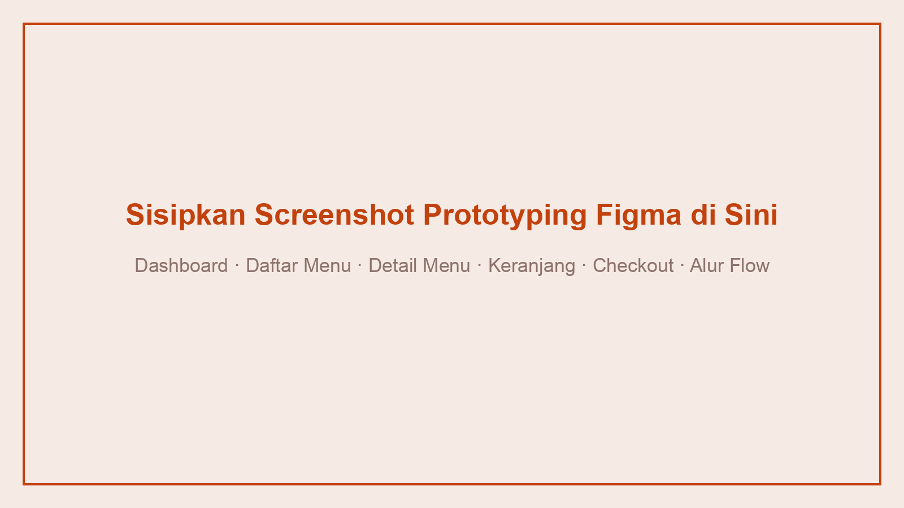{width=15cm}

### 2.5.2 Tampilan Aplikasi

Berikut tampilan aplikasi Laper! yang telah dijalankan pada emulator Android:

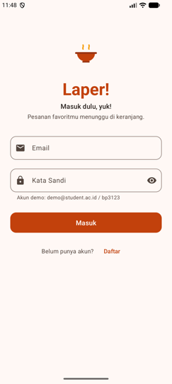{width=6.5cm}

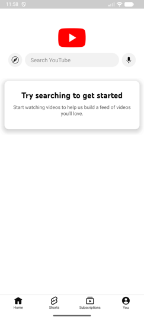{width=6.5cm}

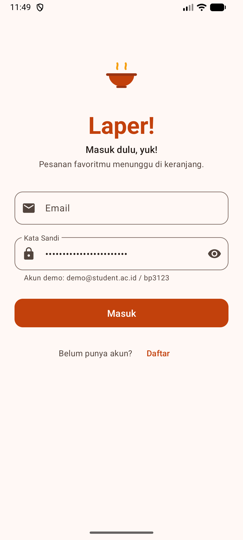{width=6.5cm}

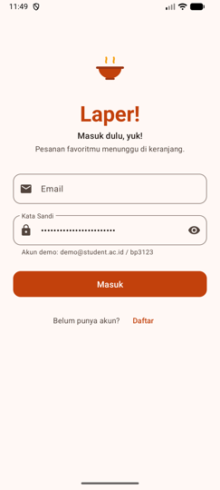{width=6.5cm}

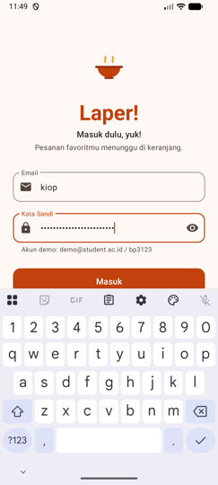{width=6.5cm}

{width=6.5cm}

{width=6.5cm}

{width=6.5cm}

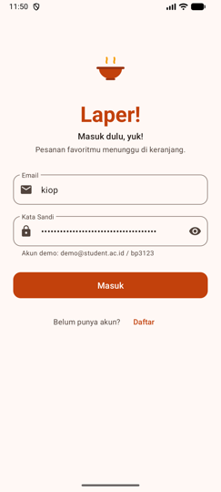{width=6.5cm}

{width=6.5cm}

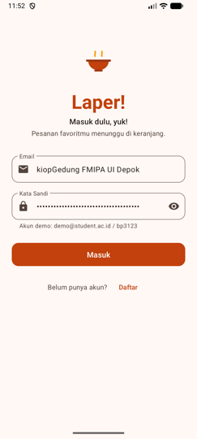{width=6.5cm}

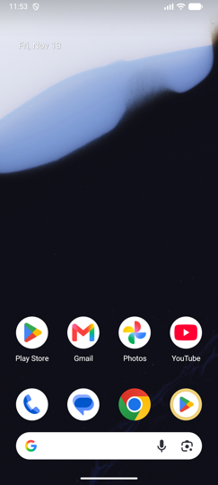{width=6.5cm}

{width=6.5cm}

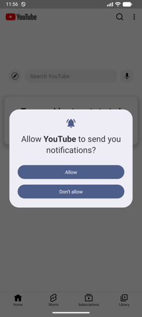{width=6.5cm}

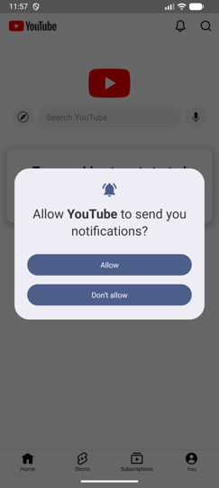{width=6.5cm}

```{=openxml}
<w:p><w:r><w:br w:type="page"/></w:r></w:p>
```

# BAB III PENUTUP

## 3.1 Kesimpulan

Aplikasi **Laper!** telah berhasil dibangun dan memenuhi seluruh ketentuan tugas akhir mata kuliah Bahasa Pemrograman 3: aplikasi terdiri dari 15 halaman (ketentuan minimal 10), memiliki halaman login, register, dashboard, daftar item berbasis RecyclerView dengan 16 item, dan halaman detail item yang terbuka dengan membawa data melalui Intent eksplisit. Aplikasi juga mendemonstrasikan Intent implisit secara nyata — membuka peta, panggilan telepon, surel, dan fitur bagikan sistem. Desain antarmuka mengikuti Material Design 3 dengan dukungan mode terang dan gelap, serta seluruh data pengguna, keranjang, dan riwayat pesanan tersimpan lokal menggunakan SharedPreferences.

## 3.2 Saran

Beberapa pengembangan yang dapat dilakukan untuk versi selanjutnya:

1. Menggunakan data dinamis melalui API publik atau backend sendiri agar data menu dan warung dapat diperbarui tanpa pembaruan aplikasi.
2. Menambahkan proses pembayaran nyata melalui payment gateway.
3. Menambahkan fitur pelacakan kurir secara langsung (real-time tracking).
4. Menerbitkan aplikasi ke Google Play Store agar dapat digunakan masyarakat luas.

```{=openxml}
<w:p><w:r><w:br w:type="page"/></w:r></w:p>
```

# DAFTAR KELOMPOK

**Kelompok [Nomor Kelompok] — Kelas [Kelas]**

| No | Nama | NIM | Pembagian Kerja |
|---|---|---|---|
| 1 | [Nama Anggota 1] | [NIM] | [Contoh: Dashboard & Daftar Menu] |
| 2 | [Nama Anggota 2] | [NIM] | [Contoh: Keranjang, Checkout & Alur Pesanan] |
| 3 | [Nama Anggota 3] | [NIM] | [Contoh: Login, Register, Profil & Desain Figma] |

```{=openxml}
<w:p><w:r><w:br w:type="page"/></w:r></w:p>
```

# LAMPIRAN

## Lampiran 1 — Link GitHub Proyek

- Kode sumber (Android): **[https://github.com/[username]/laper]**
- Rilis APK: **[https://github.com/[username]/laper/releases/tag/v1.0-demo]**

## Lampiran 2 — Akun dan Kode Demo

| Item | Nilai |
|---|---|
| Email demo | `demo@student.ac.id` |
| Kata sandi | `bp3123` |
| Kode promo | `LAPERBARU` (−Rp5.000, min. Rp25.000) · `NONGKRONYUK` (−Rp3.000, min. Rp15.000) · `MAKSIMAL8` (−Rp8.000, min. Rp50.000) · `GAJIAN20` (−Rp20.000, min. Rp100.000) |

## Lampiran 3 — Bukti Intent Implisit

Intent implisit pada aplikasi terverifikasi membuka aplikasi eksternal:

1. `ACTION_DIAL` — aplikasi telepon terbuka dengan nomor kurir terisi otomatis.
2. `ACTION_VIEW geo:` — Google Maps terbuka pada lokasi warung.
3. `ACTION_SENDTO mailto:` — aplikasi surel (Gmail) terbuka dengan penerima, subjek, dan isi pesan terisi.
